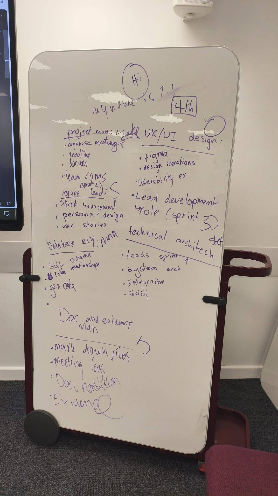

# Group Meeting Log Template (Sprint 1) - 26/03/2026

<!-- You should create one log per meeting. We expect to see at least 4 formal meetings. Create copies of this template for each meeting. -->
<!-- Logs should be in valid markdown. You can find a guide here: https://www.markdownguide.org/basic-syntax/ -->

> **Team Name / Group Number: 11 **

---

## 1. Attendance

<!-- List all team members and mark **P** (present), **A** (absent), or **L** (late). -->

| Name | Attendance |
| ---- | ---------- |
| Luke |**P**       |
| Stefan |**P**       |
| Mannat |**P**       |
| Jarryn |**P**       |
| Sajan |**L** - 10 mins |
| Olivier |**P**       |

---

## 2. Meeting Purpose

<!-- A short sentence outlining why this meeting was held. --> 

 - Understanding Assignment Requirements
 - Assigning Roles
 - Establishing Team Expectations
 - Agreeing on Workload, Deadlines and Communication Methods

## 3. Agenda Items

<!-- List the planned discussion items. -->

1. Overview of assignment requirements
2. Allocation of team roles and responsibilities
3. Selection of communication platform (Discord)
4. Agreement on meeting frequency and scheduling
5. Discussion of team expectations (workload, deadlines, communication)
6. Initial discussion of GitLab workflow and collaboration methods

---

## 4. Discussion Summary

<!-- Concise notes capturing what was discussed, decisions made, alternatives considered.
Ensure you show evidence (e.g., screenshots, links to resources) of the discussion. -->

- Roles Explained & Assigned - see Evidence
- Main communication method chosen to be Discord, Slack and Teams were considered but due to unfamiliarity  with Slack and general preference against Teams, we opted for a platform we are more comfortable with. 
- Discussed meetings scheduled (Ideally weekly)

## 5. Decisions Made

<!-- Use bullet points for clarity. Include rationale where relevant.-->

- **Decision: Communication method is Discord**  
  **Reasoning: Discord is a common app used by all members, whereas Slack is something members would need to learn**

- **Decision: Meetings would be done atleast weekly**  
  **Reasoning: Ensures all sprints are completed before deadline**

## 6. Actions and Responsibilities

<!-- Clear, assigned tasks with deadlines. -->

| Task | Assigned To | Due Date | Status                               |
| ---- | ----------- | -------- | ------------------------------------ |
|No major project activities for Sprint 1 | ----------- | -------- | N/A |

## 7. Next Meeting

**Proposed Date & Time: 07/04/2026 - 13:00**

**Proposed Agenda Items:**  
- Review Sprint 2 Objectives  
- Spitball Epics for the innovative feature  
- Generate and discuss Personas to represent target users  
- Create user-story candidates  
- Discuss selection process for final Epic, 2 Personas, 1 Scenario, and 5 User Stories  
- Set deadlines and assign tasks for Sprint 2